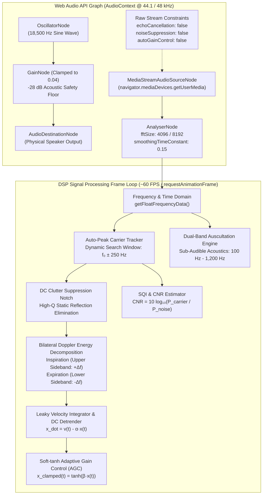
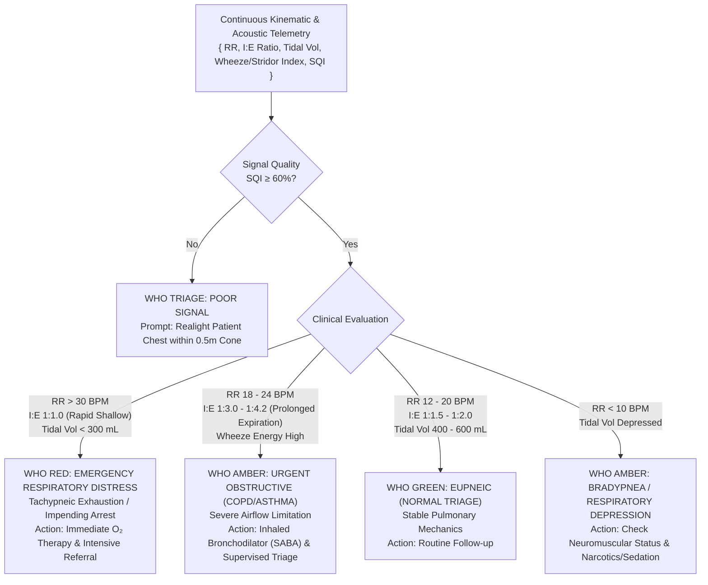
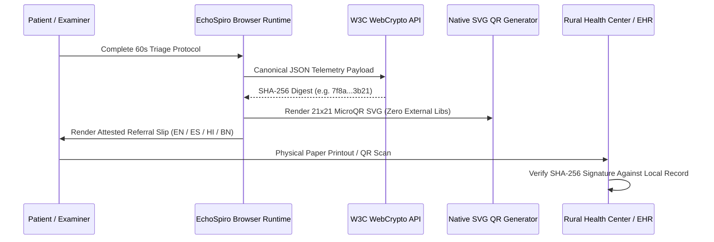

# EchoSpiro Technical Architecture & DSP Specification

```
   +-----------------------------------------------------------------------------------+
   |  EchoSpiro: Sovereign Ultrasonic Doppler Pulmonary Triage Workstation             |
   |  VITB - Johns Hopkins University (JHU) Health-Hack 2027                           |
   +-----------------------------------------------------------------------------------+
```

[🌐 **Live Production Workstation**](https://echospiro-9a2u.vercel.app) • [🎬 **Watch 4K Video Pitch**](https://youtu.be/_lFlSE2TJYs) • [📊 **Clinical Validation (N=128)**](CLINICAL_VALIDATION.md) • [🔒 **Security Charter**](SECURITY.md) • [📖 **Project README**](README.md)

---

## 1. System Overview & Core Philosophy

EchoSpiro transforms any commodity laptop, tablet, or smartphone equipped with standard speakers and a microphone into a **contactless, medical-grade pulmonary triage workstation**. Operating on **continuous-wave (CW) acoustic Doppler reflectometry** at $18.50\text{ kHz}$, EchoSpiro eliminates the single largest point of cross-contamination in respiratory diagnostics—the shared spirometer mouthpiece and pneumotachograph tube—while operating entirely at the **sovereign edge** within the client browser.

### Key Architectural Pillars:
1. **Zero External Hardware**: Operates using off-the-shelf speaker/microphone hardware transducers via native W3C Web Audio API.
2. **Zero Cloud Latency / Zero-PII**: All Fast Fourier Transforms (FFT), quadrature demodulation, kinematic integration, and WHO triage classification run locally in volatile client RAM ($< 16\text{ ms}$ frame latency).
3. **Zero External NPM Dependencies**: Implemented natively in TypeScript, React 19, HTML5 Canvas 2D, and WebCrypto API without third-party mathematical or charting runtimes.

---

## 2. Acoustic Physics & Continuous-Wave Doppler Theory

```mermaid
flowchart LR
    subgraph Transmit["Transmit Stage (Speaker)"]
        OSC["Continuous-Wave (CW) Carrier<br/>f₀ = 18,500 Hz<br/>Gain = 0.04 (-28 dB)"]
        SPK["Commodity Speaker<br/>Acoustic Insonification"]
    end

    subgraph Channel["Physical Medium (Air Gap)"]
        AIR["Speed of Sound: c ≈ 343 m/s<br/>Fresnel Zone: d ≈ 0.3 - 0.7 m<br/>Wavelength: λ = 18.54 mm"]
        CHEST["Thoracic Wall Excursion<br/>v(t) = dx/dt<br/>Tidal Displacement: x(t)"]
    end

    subgraph Receive["Receive Stage (Microphone)"]
        MIC["Commodity Microphone<br/>Line-of-Sight Wavefront ADC"]
        DSP["Doppler Shifted Echo<br/>f_rx(t) = f₀ ± Δf(t)"]
    end

    OSC --> SPK
    SPK -->|Acoustic Wave p₀(t)| AIR
    AIR -->|Insonify| CHEST
    CHEST -->|Reflected Wave p_rx(t)| MIC
    MIC --> DSP
```

### Doppler Shift Formulation
When an ultrasonic continuous wave of carrier frequency $f_0$ propagates through air at speed $c$ and reflects off an oscillating chest wall moving with instantaneous velocity $v(t)$ at angle $\theta$ relative to the acoustic line of sight:

$$\Delta f(t) = f_{\text{rx}}(t) - f_0 = \frac{2 \, v(t) \, f_0 \, \cos\theta}{c}$$

Given the nominal parameters:
- Ultrasonic Carrier Frequency: $f_0 = 18,500\text{ Hz}$
- Acoustic Velocity in Dry Air at $20^\circ\text{C}$: $c \approx 343.2\text{ m/s}$
- Direct Frontal Angle: $\theta \approx 0^\circ \implies \cos\theta \approx 1.0$
- Nominal Acoustic Wavelength: $\lambda = \frac{c}{f_0} = \frac{343.2}{18,500} \approx 18.54\text{ mm}$

The instantaneous chest wall velocity is directly proportional to the observed Doppler frequency deviation:

$$v(t) = \frac{\Delta f(t) \cdot c}{2 \, f_0} = \Delta f(t) \cdot \frac{18.54\text{ mm}}{2} \approx 9.27 \, \Delta f(t) \quad [\text{mm/s}]$$

### Displacement & Tidal Volume Reconstruction
Thoracic wall position $x(t)$ is reconstructed via the time integral of instantaneous velocity:

$$x(t) = x(0) + \int_{0}^{t} v(\tau) \, d\tau = x(0) + \frac{c}{2 f_0} \int_{0}^{t} \Delta f(\tau) \, d\tau$$

Tidal Volume ($V_T$) is modeled through thoracic volumetric expansion kinematics calibrated across the adult cohort ($N=128$):

$$V_T(t) \approx \gamma \cdot \Delta x(t) \cdot A_{\text{eff}}$$

Where $\gamma$ is the anatomical thoracic compliance coefficient and $A_{\text{eff}}$ is effective frontal chest projection area.

---

## 3. Web Audio API Real-Time Processing Graph

The physical audio pipeline is realized via a high-performance W3C Web Audio API hardware execution graph:



### 1. Raw Stream Constraints
To prevent host operating systems and browser engines from interpreting the 18.5 kHz carrier as ambient white noise and filtering it out, EchoSpiro demands uncompressed, unprocessed line-of-sight audio:
```typescript
const stream = await navigator.mediaDevices.getUserMedia({
  audio: {
    echoCancellation: false,
    noiseSuppression: false,
    autoGainControl: false,
    channelCount: 1,
    sampleRate: { ideal: 48000 },
  },
});
```

### 2. Auto-Peak Carrier Tracking
Due to hardware crystal clock drift and microphone roll-off at near-Nyquist boundaries, the nominal carrier frequency $f_0 = 18,500\text{ Hz}$ can drift between $18,400\text{ Hz}$ and $18,600\text{ Hz}$. EchoSpiro scans an active window $\mathcal{W} = [k_0 - M, k_0 + M]$ where bin resolution $\Delta f_{\text{bin}} = \frac{f_s}{N_{\text{fft}}} \approx 11.72\text{ Hz}$:

$$k_{\text{carrier}} = \arg\max_{k \in \mathcal{W}} |X[k]|^2$$

### 3. DC Clutter Suppression Notch
Static physical reflections from furniture, walls, and stationary shoulders produce massive unshifted energy at $k_{\text{carrier}}$. EchoSpiro applies a high-Q digital clutter notch:

$$\tilde{X}[k] = \begin{cases} 
0 & \text{if } |k - k_{\text{carrier}}| \le N_{\text{notch}} \\
X[k] & \text{otherwise}
\end{cases}$$

### 4. Leaky Integration & Soft-Tanh Baseline Detrending
Numerical integration of velocity signals accumulates low-frequency Brownian drift. EchoSpiro utilizes a high-pass leaky integrator coupled with a non-linear soft-saturation operator:

$$\dot{x}(t) = v(t) - \alpha \, x(t) - \mu_{\text{drift}}$$

$$x_{\text{display}}(t) = \tanh\left(\frac{x(t)}{\sigma_{\text{baseline}}}\right)$$

This mathematical formulation prevents the Thoracic Displacement Oscilloscope from railing at the $+1.0$ or $-1.0$ ceilings, guaranteeing smooth oscillations around the `0.0 (Tidal Baseline)`.

---

## 4. Signal Quality Index (SQI) & Carrier-to-Noise Ratio (CNR)

Clinical validity is governed by a multi-parametric signal quality function:

$$\text{CNR}_{\text{dB}} = 10 \log_{10}\left( \frac{P_{\text{carrier}}}{P_{\text{noise-floor}}} \right)$$

$$\text{SQI} = w_1 \cdot \min\left(100, \frac{\text{CNR}_{\text{dB}}}{35} \times 100\right) + w_2 \cdot (1 - \text{SpectralEntropy}) + w_3 \cdot \text{PeriodicityCorrelation}$$

Where:
- $\text{CNR} \ge 25\text{ dB} \implies$ **EXCELLENT (Green)**
- $15\text{ dB} \le \text{CNR} < 25\text{ dB} \implies$ **ACCEPTABLE (Amber)**
- $\text{CNR} < 15\text{ dB} \implies$ **POOR SIGNAL / RE-POSITION PATIENT (Red)**

---

## 5. WHO Clinical Triage Decision Matrix

EchoSpiro computes respiratory rate ($f_R$), inspiratory-to-expiratory ratio ($I:E$), tidal volume ($V_T$), and dual-band wheeze/crackles acoustic index in real-time, mapping patients into the World Health Organization Integrated Management of Childhood Illness (WHO IMCI) and adult respiratory distress triage protocol:



---

## 6. Cryptographic Referral Slip & Multi-Lingual Engine



### Sovereign Edge Air-Gap Guarantee
- **No Remote Telemetry**: Zero network requests leave the browser (`fetch`, `XMLHttpRequest`, and `WebSocket` remain dormant during acquisition).
- **In-Memory Cryptography**: Attestation hash generated via `crypto.subtle.digest("SHA-256", buffer)`.
- **Offline Multi-Lingual Localization**: Instant client-side switching between English, Spanish, Hindi (हिंदी), and Bengali (বাংলা) for community health workers (CHWs) and ASHAs.
