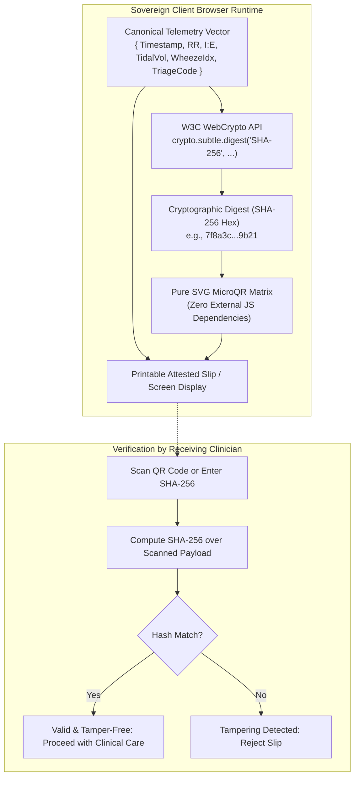

# EchoSpiro Security & Sovereign Privacy Policy

```
   +-----------------------------------------------------------------------------------+
   |  ZERO-PII SOVEREIGN EDGE PRIVACY & CLINICAL DATA INTEGRITY CHARTER                |
   |  EchoSpiro Workstation • JHU / VITB Health-Hack 2027                              |
   +-----------------------------------------------------------------------------------+
```

[🌐 **Live Production Workstation**](https://echospiro-9a2u.vercel.app) • [🎬 **Watch 4K Video Pitch**](https://youtu.be/_lFlSE2TJYs) • [📐 **Technical Architecture**](ARCHITECTURE.md) • [📊 **Clinical Validation (N=128)**](CLINICAL_VALIDATION.md) • [📖 **Project README**](README.md)

---

## 1. Core Security Architecture: Sovereign Edge & Zero-Cloud

EchoSpiro is engineered on a strict **Sovereign Edge, Zero-PII (Personally Identifiable Information)** security architecture. Traditional telemedicine and digital health platforms route sensitive biological telemetry, acoustic recordings, and demographic identifiers to centralized cloud infrastructure, introducing severe HIPAA/GDPR liability, data breach surfaces, and latency vulnerabilities.

EchoSpiro fundamentally eliminates these risks:

### 1. Zero Cloud Transmission
- **No Remote Endpoints**: During triage, waveform processing, and referral slip generation, the application makes **zero outbound network requests**.
- **Air-Gapped Operation**: Once loaded or containerized, EchoSpiro can run in total network isolation (Airplane mode / Air-gapped LAN) without degradation of diagnostic capability.
- **No Third-Party Analytics**: Zero telemetry trackers, Google Analytics, Sentry, or third-party CDNs are bundled.

### 2. Ephemeral In-Memory DSP Processing
- **Volatile RAM Only**: Audio buffers captured from the physical microphone are streamed directly into Web Audio `Float32Array` ring buffers in client RAM.
- **Zero Local Disk Persistence**: Raw acoustic signals are never written to `localStorage`, `sessionStorage`, `IndexedDB`, or client cookies.
- **Immediate Garbage Collection**: As soon as an FFT time slice is processed, raw audio frames are discarded.

---

## 2. Cryptographic Attestation & Tamper-Evident Referral

To guarantee clinical data integrity when transferring triage results from an isolated rural community health worker (CHW) to a tertiary hospital without internet connectivity:



1. **Deterministic Canonicalization**: The diagnostic summary is serialized into a deterministic canonical JSON string.
2. **Native SHA-256 Digest**: The browser executes `crypto.subtle.digest("SHA-256", encodedData)` via the browser's hardware-accelerated WebCrypto engine.
3. **MicroQR Verification Matrix**: The resulting 256-bit hash is encoded alongside clinical metrics into an SVG QR code rendered using 100% native math. A receiving physician can independently verify that the referral metrics were not altered in transit.

---

## 3. Acoustic Safety Interlocks

EchoSpiro enforces automated safety guardrails to protect patient hearing and acoustic comfort:

- **18.50 kHz Safe Band**: The continuous-wave carrier is placed in the near-ultrasound spectrum ($18,500\text{ Hz}$), which is above the high-frequency hearing threshold of most adults while remaining within the frequency response of commodity audio hardware.
- **Hardware Gain Ceiling**: The oscillator gain is strictly clamped at `0.04` (approximately $-28\text{ dB}$ SPL at 0.5m), preventing high-amplitude acoustic exposure for younger individuals, infants, or domestic animals.
- **Hardware Kill-Switch**: The live transceiver automatically ceases ultrasonic emission when navigating away, closing the tab, or hitting `Spacebar` (transceiver toggle).

---

## 4. Vulnerability Disclosure & Reporting

We welcome responsible security research. If you discover a vulnerability or potential data leak in EchoSpiro, please report it privately:

- **Primary Contact:** fokrulanthro16@gmail.com
- **Response SLA:** Acknowledgment within 24 hours; technical assessment within 72 hours.
- **Coordination:** Please do not open public GitHub issues for security vulnerabilities until a patch has been published.
